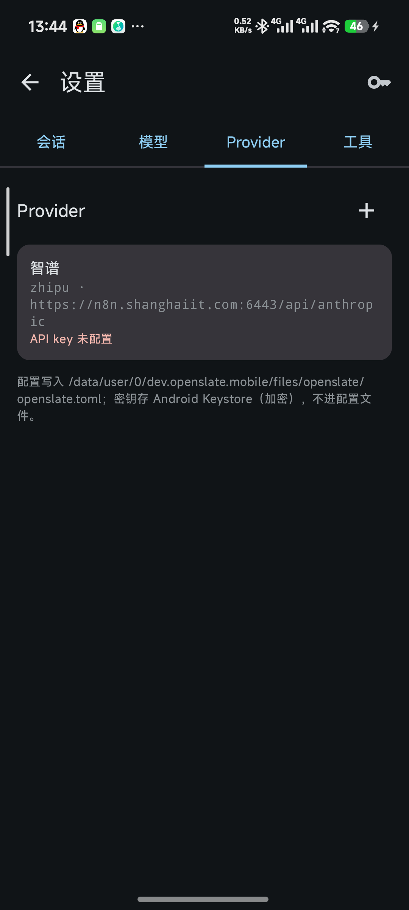

# OpenSlate

跑在 Android 手机上的 LLM Agent，与桌面端共享同一套 Rust 核心。

  

OpenSlate 是一个完整的手机端 Agent：会话循环、上下文压缩、工具调用、审批与成本统计，全部在一套 Rust 核心里完成，这套核心直接编译进 App——Agent 逻辑不经过任何中转服务，也不需要一台常开待命的电脑。

桌面端不是移植，而是同一套核心的另外几个入口，两端行为一致，因为它们本来就是同一份代码。

## Android 端

- **手机上跑真命令。** shell 工具直接在设备上执行，有两条路径可选：进程内系统 sh（toybox，零依赖、零授权），或经 Termux 的 RUN_COMMAND 直传——命令下发与结果回传都在手机上闭环，全程不需要 PC 或 adb。
- **密钥不出安全边界。** API Key 存入 Android Keystore 并以 AES-GCM 加密，任何配置文件里都找不到明文，重启后自动重注入。
- **会话经得起重启。** 会话落在本地 SQLite，重开 App 自动恢复最近对话，历史页随时切换续聊；上下文超限时自动压缩，长任务不被窗口大小卡住。
- **为阅读而生的界面。** Markdown 渲染、思维链折叠、相邻的工具调用聚合成一张卡片、需要授权的操作弹出审批横幅，每条回复都看得到 token 成本。
- **从 Android 8 到 Android 17。** 最低支持 API 26，实测设备覆盖 2017 年的华为 P10 lite 到运行 Android 17 的小米 15 Pro。

## 模型接入

支持 OpenAI 兼容、Anthropic、Gemini 三类 Provider。流式输出、思维链（含 Anthropic thinking block 的多轮回传）、usage 统计均有完整处理。

输入任意 model id，内置的模型注册表会自动补全它的上下文窗口、输出限额、计价与能力标记。数据由 models.dev、LiteLLM 等多个来源合并而来，压缩后常驻本地，查询不耗流量。

## 桌面端

同一套核心的三个入口：`openslate serve` 把会话暴露为 HTTP + WebSocket 服务；TUI 作为纯客户端 attach 上去，支持自动发现与断线重连；CLI 提供 `run` 与 REPL。

## 开发

架构、构建与 Android 交叉编译的完整文档见 `docs/guide/`。

## License

MIT
